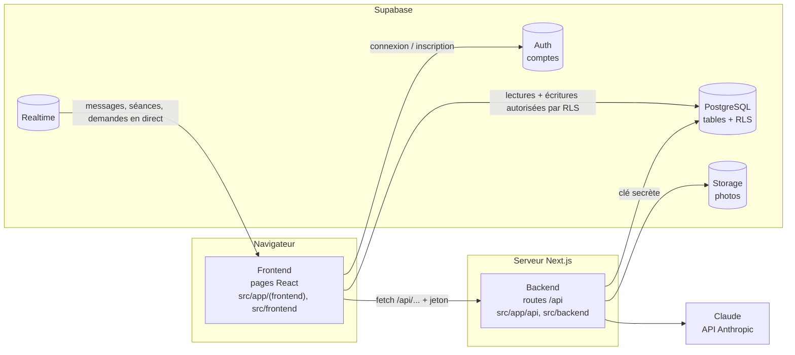
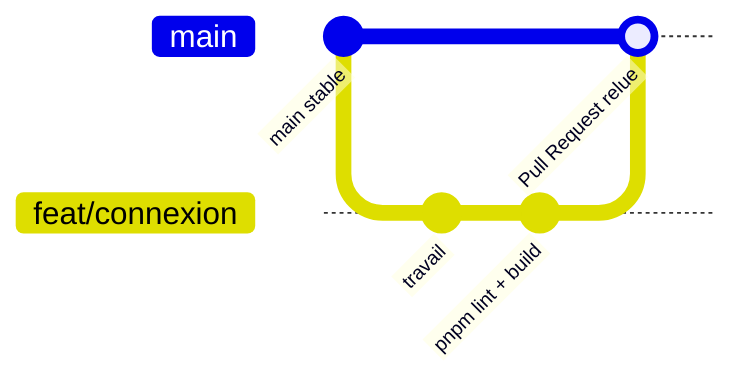

# Architecture de LirePlus

Ce document explique comment le projet est découpé — **frontend**, **backend**, **base de données**, **GitHub** —
et comment ces morceaux communiquent. Pour l'installation, voir le [README](../README.md) ;
pour la façon de travailler en équipe, voir [CONTRIBUTING](../CONTRIBUTING.md).

## Vue d'ensemble

LirePlus est **une seule application Next.js**. Le frontend et le backend vivent dans le même dépôt et
démarrent ensemble avec une seule commande (`pnpm dev`). La base de données est hébergée chez **Supabase**.



| Bloc | Où | Rôle |
|---|---|---|
| Frontend | `src/app/(frontend)/`, `src/frontend/` | Les pages et l'interface, exécutées dans le navigateur |
| Backend | `src/app/api/`, `src/backend/` | Validation finale, écritures sensibles, IA ; exécuté uniquement sur le serveur |
| Partagé | `src/shared/` | Types, données de démo, règles de validation utilisées des deux côtés |
| Base de données | `supabase/` (+ projet Supabase en ligne) | Tables, règles de sécurité (RLS), stockage des photos, temps réel |
| GitHub | `.github/`, branches | Historique, relecture du code par Pull Request |

## 1. Frontend

```
src/app/(frontend)/      une page = un dossier (le nom entre parenthèses n'apparaît pas dans l'URL)
  page.tsx               tableau de bord  →  /
  connexion/             connexion, inscription, mot de passe oublié
  reinitialiser-mot-de-passe/
  bienvenue/             questionnaire d'accueil
  profil/ mentors/ demandes/ seances/ ateliers/ messages/ objectifs/ ressources/ opportunites/ temoignages/ domaines/
src/frontend/
  components/            éléments d'interface réutilisables (ui.tsx, Navigation, auth/…)
  store/                 état de l'application, choisi automatiquement :
    store-demo.tsx         mode démo — données dans le navigateur (localStorage)
    store-supabase.tsx     mode multi-utilisateurs — données dans Supabase
  lib/                   client Supabase du navigateur, appels à l'API, traitement d'image
```

**Règle :** une page ne parle jamais directement à la base ni au serveur. Elle utilise `useStore()`,
et c'est le store qui décide d'appeler Supabase ou le backend. Ainsi, la même page marche en mode démo et en mode Supabase.

**Accès aux pages :** en mode Supabase, un visiteur non connecté est renvoyé vers `/connexion`.
Seules `/connexion` et `/reinitialiser-mot-de-passe` sont publiques (`PAGES_PUBLIQUES` dans `store-core.ts`).

## 2. Backend

```
src/app/api/                    points d'entrée HTTP (fichiers courts)
  profil/route.ts               PUT    enregistrer le profil
  profil/photo/route.ts         POST   enregistrer la photo
  demandes/route.ts             POST   envoyer une demande de mentorat
  demandes/[id]/route.ts        PATCH  le mentor accepte ou décline
  recommandation/route.ts       POST   mentors recommandés par l'IA
  parcours/route.ts             POST   parcours personnalisé par l'IA
src/backend/                    logique serveur (protégée par le paquet "server-only")
  db/supabase-admin.ts          client Supabase avec la clé secrète
  services/                     profils, demandes, authentification, IA (Claude)
  validation/                   contrôles propres au serveur (photos)
```

Chaque appel du frontend joint le **jeton de l'utilisateur connecté** (`Authorization: Bearer …`, voir `frontend/lib/api.ts`).
Le backend vérifie ce jeton (`services/auth.ts`), **revalide les données** avec les règles de `src/shared/validation/`,
puis écrit en base avec la clé secrète.

**Ce qui passe par le backend, et pourquoi :**

| Action | Pourquoi pas directement depuis le navigateur |
|---|---|
| Profil, photo | Les règles RLS interdisent au navigateur de modifier un profil ; le serveur vérifie le vrai format de l'image |
| Demandes de mentorat | Règles métier (une seule relation active par binôme, seul le mentor répond) |
| Recommandation, parcours IA | La clé `ANTHROPIC_API_KEY` ne doit jamais arriver dans le navigateur ; repli sur un algorithme local sans clé |

Les autres actions (séances, messages, objectifs, favoris, ateliers, témoignages, opportunités) sont écrites
**directement** par le navigateur dans Supabase : les règles RLS garantissent que chacun ne touche qu'à ses propres données.

## 3. Base de données (Supabase)

Le fichier de référence est [`supabase/schema.sql`](../supabase/schema.sql) ; il se rejoue sans risque (`if not exists`).
[`supabase/seed.sql`](../supabase/seed.sql) ajoute les mentors et opportunités de démo (généré par `scripts/generer-seed.mjs`).

| Table | Contenu |
|---|---|
| `profiles` | Mentors et mentorés (créé automatiquement à l'inscription par le trigger `handle_new_user`) |
| `demandes_mentorat` | Demandes mentoré → mentor et leur réponse |
| `seances` | Séances planifiées, évaluations |
| `messages` | Messagerie entre utilisateurs |
| `objectifs` | Objectifs et leurs étapes |
| `opportunites` | Stages, emplois, bourses… |
| `favoris` | Mentors mis en favori |
| `ateliers`, `inscriptions_ateliers` | Ateliers collectifs et inscrits |
| `temoignages` | Retours d'expérience |

En plus des tables :
- **Auth** : comptes email + mot de passe ;
- **RLS** : 18 règles qui limitent ce que chaque utilisateur peut lire et écrire ;
- **Storage** : le bucket `avatars` (photos, 2 Mo maximum, JPEG/PNG/WebP), écrit uniquement par le backend ;
- **Realtime** : `messages`, `seances` et `demandes_mentorat` sont poussés en direct aux navigateurs.

**Modifier la base :** changer `schema.sql`, le relancer dans *SQL Editor* de Supabase, et prévenir l'équipe
(chacun relance le script sur son projet s'il en a un).

## 4. Configuration (`.env.local`)

| Variable | Utilisée par | Secrète ? |
|---|---|---|
| `NEXT_PUBLIC_SUPABASE_URL` | frontend + backend | non |
| `NEXT_PUBLIC_SUPABASE_KEY` | frontend | non (la sécurité repose sur RLS) |
| `SUPABASE_SECRET_KEY` | backend uniquement | **oui** — ne jamais la commiter ni la partager |
| `ANTHROPIC_API_KEY` | backend uniquement | **oui** |

Sans `NEXT_PUBLIC_SUPABASE_URL`, l'application démarre en **mode démo** (pas de comptes, données locales).
Le fichier `.env.local` est ignoré par Git ; seul `.env.example` est versionné.

## 5. GitHub

Dépôt : `github.com/tadbarry224/Lirepluss`.



- `main` reste toujours présentable au jury : **personne ne pousse directement dessus**.
- Une branche par tâche : `feat/…`, `fix/…`, `style/…`, `docs/…`.
- Avant d'ouvrir une Pull Request : `pnpm lint` et `pnpm build`. Le modèle `.github/pull_request_template.md` sert de checklist.
- Fusion en *Squash and merge* après relecture par un coéquipier.

Le détail des commandes et la répartition des dossiers par personne sont dans [CONTRIBUTING](../CONTRIBUTING.md).

## Exemple de bout en bout : l'inscription

1. Sur `/connexion`, le formulaire valide les champs avec `shared/validation/auth.ts`.
2. Le navigateur appelle **Supabase Auth** (`signUp`) avec le nom et le rôle.
3. Dans la base, le trigger `handle_new_user` crée la ligne `profiles` correspondante.
4. Le store reçoit la session et redirige de `/connexion` vers `/`.
5. Le tableau de bord voit un profil sans domaines et envoie vers `/bienvenue` (questionnaire).
6. Le questionnaire enregistre le profil via `PUT /api/profil` : le backend revalide et écrit en base.
   L'utilisateur voit alors ses premiers mentors recommandés, puis accède au tableau de bord.
